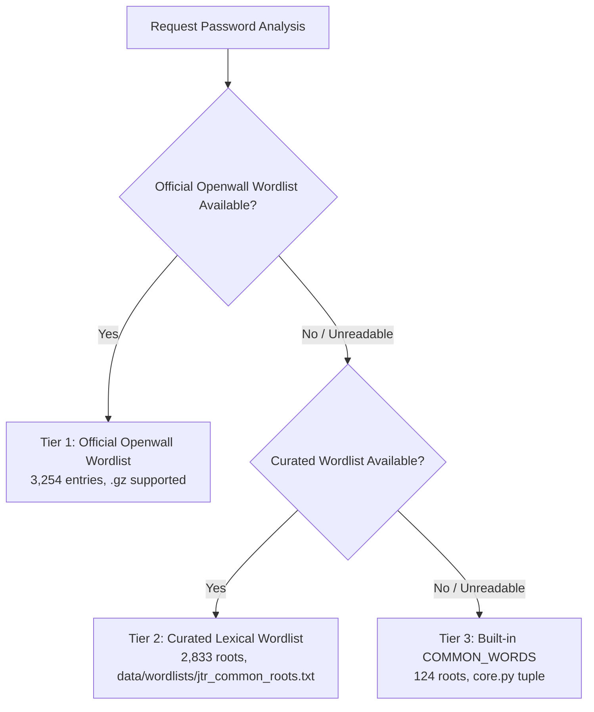

# Official Openwall Wordlist Integration & Provenance

## 1. Overview & Provenance

This document details the provenance, licensing, technical specifications, and retrieval instructions for the official **Openwall Wordlists Collection** integrated into the Password Mutation Analysis project.

| Field | Detail |
| :--- | :--- |
| **Provider** | Openwall Project |
| **Author / Compiler** | Solar Designer (Alexander Peslyak) |
| **Collection Homepage** | [https://www.openwall.com/wordlists/](https://www.openwall.com/wordlists/) |
| **Archive Directory** | [https://download.openwall.net/pub/wordlists/passwords/](https://download.openwall.net/pub/wordlists/passwords/) |
| **Official Download URL** | `https://download.openwall.net/pub/wordlists/passwords/password.gz` |
| **File Name** | `password.gz` |
| **Version / Last Modified** | `2011/11/20 20:12:00 GMT` (Header tag: `Last update: 2011/11/20 (3546 entries)`) |
| **Retrieval Date** | October 12, 2026 |
| **Compressed Size** | 13,604 bytes (~13.3 KB) |
| **Uncompressed Size** | 26,215 bytes (~25.6 KB) |
| **Compressed SHA-256 Checksum** | `1e7a12ddd07cfbdd7c3b774230be33968e506072ae6fec4ff195b577f51fb6c1` |
| **Uncompressed SHA-256 Checksum** | `2dd79902220fa879a330d9246da147984b705087a52ad17de3803acfafe7badc` |
| **Total Lines in File** | 3,557 lines (11 header comment lines, 3,546 raw password entries) |
| **Unique Normalized Lexical Roots** | 3,254 entries (excluding pure numbers and tokens under 3 characters) |

---

## 2. Applicable License & Redistribution Terms

The wordlist is licensed by Solar Designer under the official Openwall Wordlists Collection license ([https://www.openwall.com/wordlists/LICENSE.shtml](https://www.openwall.com/wordlists/LICENSE.shtml)):

```text
Copyright (c) 2002, 2003, 2015 by Solar Designer of Openwall Project

You're allowed to use and redistribute this wordlists collection or
parts thereof, with or without modification, provided that credit is
given where it is due, any modified versions are marked as such, this
license is kept intact and included with each copy, and NO FEE IS
CHARGED FOR OBTAINING A COPY except as negotiated with the copyright
holder. In particular, you are NOT permitted to charge for bandwidth,
physical media, and/or shipping. You're also not permitted to bundle
this wordlists collection with a product you charge for.
```

The license file is bundled locally at [`data/wordlists/OPENWALL_LICENSE.txt`](file:///c:/Users/KUDSIT/Documents/NB/Password_mutation/data/wordlists/OPENWALL_LICENSE.txt).

---

## 3. Manual Retrieval Instructions

To adhere to security best practices and ensure zero external network calls occur during application startup, the application does not automatically download external files on boot. Developers and system administrators can manually retrieve or refresh the official Openwall dictionary using one of the following methods:

### Method A: Using the Provided Verification Script
```bash
python scripts/fetch_openwall_wordlist.py
```
This script downloads `password.gz` directly from `https://download.openwall.net/pub/wordlists/passwords/password.gz`, validates the SHA-256 checksum against `1e7a12ddd07cfbdd7c3b774230be33968e506072ae6fec4ff195b577f51fb6c1`, and stores it at `data/wordlists/openwall_passwords.txt.gz`.

### Method B: Using curl or wget
```bash
# Using curl:
curl -o data/wordlists/openwall_passwords.txt.gz https://download.openwall.net/pub/wordlists/passwords/password.gz

# Verify SHA-256 on Linux/macOS:
sha256sum data/wordlists/openwall_passwords.txt.gz
# Expected: 1e7a12ddd07cfbdd7c3b774230be33968e506072ae6fec4ff195b577f51fb6c1

# Verify SHA-256 on Windows (PowerShell):
Get-FileHash data/wordlists/openwall_passwords.txt.gz -Algorithm SHA256
```

---

## 4. Multi-Tier Wordlist Hierarchy & Fallback Architecture

The engine implements a robust three-tier fallback mechanism:



1. **Tier 1 (Official Openwall):** Configurable via `OPENWALL_WORDLIST_PATH` or explicit path argument, or bundled at `data/wordlists/openwall_passwords.txt.gz`.
2. **Tier 2 (Curated Fallback):** Curated lexical root dictionary (`data/wordlists/jtr_common_roots.txt`) with 2,833 high-frequency English password roots.
3. **Tier 3 (Built-in Fallback):** Hard-coded `COMMON_WORDS` tuple in `password_analyzer/core.py` (124 entries) ensuring zero-dependency operation.
